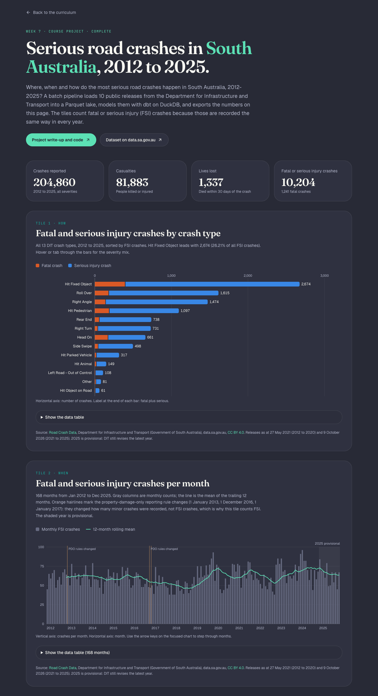
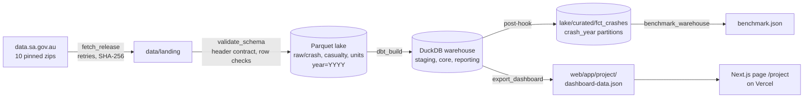

# Serious road crashes in South Australia: a batch data pipeline

> Part of my [Data Engineering Zoomcamp 2024 study repo](../../README.md). This is the Week 7 course project.

**Completed in October 2026 with Claude as a pair programmer.**

- Project brief: [DE Zoomcamp course project](https://github.com/DataTalksClub/data-engineering-zoomcamp/blob/main/projects/README.md) and the [2024 cohort project page](https://github.com/DataTalksClub/data-engineering-zoomcamp/blob/main/cohorts/2024/project.md)
- Live dashboard: [data-engineer-bootcamp-pink.vercel.app/project](https://data-engineer-bootcamp-pink.vercel.app/project)
- Real run output: [RUN_LOG.md](RUN_LOG.md)

The pipeline downloads ten public releases of South Australia's road crash data (2012 to 2025), checks them against pinned checksums, lands them in a year-partitioned Parquet lake, models them with dbt on DuckDB, measures what partitioning and clustering buy, and exports a deterministic JSON file that a static dashboard page reads. Everything runs on a laptop or in GitHub Actions with free tools and no cloud account.



## Evaluation criteria: self-assessment

The course scores seven criteria from 0 to 4. This is my own reading of the rubric, not a peer review.

| Criterion | Where | Self-assessment |
|---|---|---|
| Problem description | [Problem description](#problem-description) | 4: the question, why it matters and the three sub-questions are stated |
| Cloud | [Cloud and infrastructure as code](#cloud-and-infrastructure-as-code-local-no-cloud-account) | **0 by the rubric**: nothing runs in a cloud. Terraform is used, but for local folders and config and for a Docker run in CI, so the "cloud + IaC" points do not apply |
| Data ingestion (batch) | [Data ingestion](#data-ingestion-batch-workflow-orchestration-with-prefect) | 4 if a local lake counts: a Prefect DAG with six task types, retries, checksums and a weekly schedule, writing to a Parquet lake in local folders that stand in for GCS |
| Data warehouse | [Data warehouse](#data-warehouse-partitioning-and-clustering-in-duckdb) | 2, or 4 if representative queries and a local warehouse count: `fct_crashes` is clustered and has a year-partitioned copy, with the reasoning and a benchmark, but the dashboard's own models aggregate every year from the unpartitioned DuckDB table, so the partitions serve representative year-bounded queries that the pipeline does not run. DuckDB stands in for BigQuery |
| Transformations | [Transformations with dbt](#transformations-with-dbt) | 4: dbt models in staging, intermediate, core and reporting layers, with 64 data tests |
| Dashboard | [Dashboard](#dashboard) | 4: two required tiles (categorical and temporal) plus a third tile and supporting tables |
| Reproducibility | [Reproducibility](#reproducibility) | 4: `make setup && make all` from a clean clone, and CI runs the same steps on every push |

## Problem description

**Where, when and how do the most serious road crashes happen in South Australia, 2012 to 2025?**

South Australia's Road Safety Strategy to 2031 sets ten-year targets of reducing lives lost by 50% and serious injuries by 30% by 2031 ([Department for Infrastructure and Transport, Action Plan 2025-2027 announcement](https://dit.sa.gov.au/news?a=1442005); [strategy page](https://thinkroadsafety.sa.gov.au/road-safety-strategy)). Progress against targets like these is tracked on fatal and serious injury (FSI) crashes, not on all crashes. The state publishes every reported crash as open data, but as yearly zip files with three CSVs each, inconsistent council names across releases, and reporting rule changes buried in a metadata PDF. A reader cannot answer simple questions without first doing the engineering.

This project turns those releases into a tested, reproducible dataset and a small dashboard that answers three questions:

1. **When:** how have monthly FSI crashes, and annual lives lost and serious injuries, moved since 2012?
2. **How:** which crash types produce the most FSI crashes, and how does the severity mix differ by type?
3. **Where (supporting):** which council areas (LGAs) and which statistical areas (City, Metropolitan, Country) carry the most FSI crashes?

The dashboard deliberately counts FSI crashes rather than all crashes. The rules for recording property-damage-only (PDO) crashes changed three times in the period, so a time series of all crashes would mostly show reporting rules, not road safety.

## Dataset

| | |
|---|---|
| Name | Road Crash Data |
| Publisher | Department for Infrastructure and Transport (DIT), Government of South Australia |
| URL | <https://data.sa.gov.au/data/dataset/road-crash-data> (CKAN id `21386a53-56a1-4edf-bd0b-61ed15f10acf`) |
| Licence | [Creative Commons Attribution 4.0 (CC BY 4.0)](http://creativecommons.org/licenses/by/4.0) |
| Attribution | Road Crash Data, Department for Infrastructure and Transport (Government of South Australia), data.sa.gov.au, CC BY 4.0 |
| Access | Plain HTTPS downloads, no account or key |
| Size | 10 zips, 15,563,601 bytes in total; 140,553,251 bytes (about 134 MiB) of CSV once unzipped |

The NYC taxi data used in the course modules is not allowed for the project, so I picked a public dataset from my own state.

**Pinned releases** ([`pipeline/sources.yml`](pipeline/sources.yml) holds the full SHA-256 of each file):

| Years | File | Bytes | As at |
|---|---|---|---|
| 2012 | `2012_data_sa_as_at_20210527.zip` | 1,628,505 | 27 May 2021 |
| 2013 | `2013_data_sa_as_at_20210527.zip` | 1,257,991 | 27 May 2021 |
| 2014 | `2014_data_sa_as_at_20210527.zip` | 1,221,928 | 27 May 2021 |
| 2015 | `2015_data_sa_as_at_20210527.zip` | 1,168,394 | 27 May 2021 |
| 2016 | `2016_data_sa_as_at_20210527.zip` | 1,259,179 | 27 May 2021 |
| 2017 | `2017_data_sa_as_at_20210527.zip` | 1,001,803 | 27 May 2021 |
| 2018 | `2018_data_sa_as_at_20210527.zip` | 1,024,690 | 27 May 2021 |
| 2019 | `2019_data_sa_as_at_20210527.zip` | 980,081 | 27 May 2021 |
| 2020 | `2020_data_sa_as_at_20210527.zip` | 865,285 | 27 May 2021 |
| 2021 to 2025 | `2021-2025_data_sa_crash_as_at_20261009.zip` | 5,155,745 | 9 October 2026 |

**Newer extracts of 2018 to 2020 exist, and this project does not use them.** Besides the files above, the dataset page has three earlier five-year files: 2018 to 2022 as at 12 July 2023, 2019 to 2023 as at 13 September 2024, and 2020 to 2024 as at 19 September 2025 (and a 2021 file as at 6 July 2022, which the 2021-2025 file replaces). They hold later versions of 2018, 2019 and 2020 than the May 2021 files used here. The manifest only takes whole releases whose years do not overlap: [`pipeline/sources.py`](pipeline/sources.py) rejects a year claimed by two releases, and the dbt test `assert_release_years_disjoint` checks the loaded data. Each of those five-year files overlaps the 2021-2025 file, so using one would need a per-release year filter (for example, take only 2020 from the 2020-2024 file), which I have not built. So 2018 to 2020 here miss any revisions DIT made after May 2021. For the years it covers, the 2021-2025 file is the newest: DIT notes that its 2024 data has been updated and includes records that earlier releases did not.

**Columns.** Each zip holds three CSVs:

- `*_DATA_SA_Crash.csv`, one row per crash: `REPORT_ID`, location (statistical area, suburb, postcode, LGA name, `ACCLOC_X`/`ACCLOC_Y`), totals (units, casualties, fatalities, serious and minor injuries), timing (year, month name, weekday name, 12-hour time, and from 2021 a full `Crash Date Time`), road and weather conditions, crash type (13 values), CSEF severity (`1: PDO`, `2: MI`, `3: SI`, `4: Fatal`), and DUI and drug flags.
- `*_DATA_SA_Casualty.csv`, one row per person hurt: unit and casualty number, casualty type, sex, age, injury extent (Fatal, Admitted to Hospital, Treated at Hospital, By Private), seat belt and helmet use.
- `*_DATA_SA_Units.csv`, one row per vehicle, pedestrian, animal or object involved: unit type, vehicle year, controller age and sex, licence, movement, rollover and fire flags.

**Caveats, all handled in code or labelled on the dashboard:**

- **PDO reporting rules changed** on 1 January 2013, 1 December 2016 (one month under the ATSB guidelines) and 1 January 2017, according to DIT's metadata PDF (`metadata-for-road-crash-data-20251215.pdf`). All-crash counts are not comparable across those dates. The four regimes are a dbt seed, every crash carries its `pdo_regime_id`, and the time-series tile uses FSI crashes and marks the change dates.
- **The latest year is provisional.** DIT revises the most recent year in later extracts, so 2025 is flagged `is_provisional` and shaded on the dashboard.
- **Fatality means a death within 30 days of the crash**, and a serious injury means an admission to hospital, per the DIT definitions.
- **Coordinates** are in GDA2020 Lambert conformal conic (EPSG:8059), in metres. They are carried through but not mapped.
- **Council names changed spelling** between the 2012-2020 and 2021-2025 extracts (`CC MARION.` versus `CC MARION`, 33 councils in all). A seed maps them, and a dbt test fails if a new spelling appears.
- **1,665 crashes have no LGA** recorded, all of them in the Country statistical area. They are grouped as `UNINCORPORATED OR UNKNOWN`, separate from DIT's own three unincorporated-area groupings. None of these four names is a council, so the council ranking leaves them out and the dashboard lists them separately.

## Architecture



| Layer | Tool | Local stand-in for |
|---|---|---|
| Orchestration | Prefect 3.8 (ephemeral local mode), `flow.serve` for the schedule | Prefect Cloud or Airflow on a VM |
| Landing zone and data lake | Local folders, Hive-partitioned Parquet written by DuckDB | Google Cloud Storage buckets |
| Data warehouse | DuckDB 1.5 file | BigQuery dataset |
| Transformations | dbt-core 1.12 with dbt-duckdb 1.11 | dbt with the BigQuery adapter |
| Infrastructure as code | Terraform 1.16 (`hashicorp/local`, `kreuzwerker/docker`) | Terraform with the Google provider |
| Container | Dockerfile, run by Terraform in CI | Cloud Run job |
| Dashboard | Static Next.js 16 page with SVG charts, deployed on Vercel | Looker Studio |
| CI | GitHub Actions | Cloud Build |

Tools beyond the course: **DuckDB** is an in-process analytical database (a single file, SQL, reads and writes Parquet); **dbt-duckdb** is the dbt adapter for it.

## Cloud and infrastructure as code (local, no cloud account)

This project uses no cloud account, keys or paid services, so by the rubric it scores 0 for Cloud. I still kept the infrastructure as code, framed honestly as local IaC:

- [`infra/terraform/local/`](infra/terraform/local) uses `hashicorp/local` (`~> 2.9`, 2.9.1 locked). It creates the landing, lake (raw and curated), warehouse and config folders, and renders `data/config/pipeline.env` and a dbt `profiles.yml` with absolute paths from templates. It is the local equivalent of creating buckets and a dataset. Run it with `make infra-local`. I ran it with Terraform 1.16.6 only. OpenTofu is untested: the lock files are keyed to `registry.terraform.io`, so `tofu init` would probably rewrite them.
- [`infra/terraform/docker/`](infra/terraform/docker) uses `kreuzwerker/docker` (`~> 4.6`, 4.6.0 locked). It builds the project [`Dockerfile`](Dockerfile) and runs the whole pipeline once as a container (`attach = true`, `logs = true`, `must_run = false`) with the data folder bind-mounted at `/data`. Terraform waits for the container to exit and exposes its exit code and logs as outputs. Docker is not running on my laptop, so this stack runs in GitHub Actions, where CI asserts exit code 0, checks the container's JSON export byte for byte against the committed file, and then destroys the stack.

Both stacks commit their `.terraform.lock.hcl` with hashes for Linux and macOS, and CI runs `terraform fmt -check -recursive` and `terraform validate`.

## Data ingestion: batch workflow orchestration with Prefect

The data is published once a year, so this is a batch pipeline. [`pipeline/flow.py`](pipeline/flow.py) defines the Prefect 3 flow `sa_crash_pipeline`. Prefect runs in ephemeral mode: the flow starts a temporary local API server and stops it at the end, so there is nothing to sign up for. The DAG, per release and then once:

1. **`fetch_release`** (Prefect `retries=2`): [`pipeline/ingest.py`](pipeline/ingest.py) downloads with `requests`, a 60-second timeout and its own retry loop with exponential backoff for 5xx responses and connection errors. A 404 or 410 fails immediately with `SourceNotFoundError` and a message to check the dataset page. The file is streamed to a `.part` file, its size and SHA-256 are checked against the manifest, and only then is it renamed into `data/landing`. A cached file that still matches the pin is reused, which is what the CI cache restores.
2. **`validate_schema`** extracts only the three expected CSVs (by base name, so a crafted archive cannot write elsewhere) and checks the header contract: every required column present, no unknown columns, no duplicates. `Crash Date Time` is allowed as the one optional column. It then checks `REPORT_ID` is unique and that every crash year sits inside the release's declared years.
3. **`load_to_lake`** uses DuckDB to cast types (strict casts, so a bad value fails the load instead of becoming NULL), add lineage columns (`_release_id`, `_as_at`, `_ingested_from`), and write `data/lake/raw/{crash,casualty,units}/year=YYYY/part_0.parquet`. Casualty and unit rows take the crash year, so all three tables share partitions. The release's year folders are deleted first, which makes a re-run idempotent and lets a newer extract replace only its own years.
4. **`dbt_build`** runs `dbt build` in-process through `dbtRunner` (models, seeds and every data test).
5. **`benchmark_warehouse`** measures the partitioning and clustering (below).
6. **`export_dashboard`** writes the dashboard JSON: sorted keys, two-decimal rounding, no wall-clock timestamp. It refuses to write if the tiles do not add up to the same totals.

After the loads the flow also stores the release manifest in the lake (`raw/releases/releases.parquet`) and removes any year partition that no release covers.

**Schedule.** [`pipeline/serve.py`](pipeline/serve.py) serves the flow with `Cron("0 3 * * 1", timezone="Australia/Adelaide")`, a weekly check at 03:00 on Mondays (`make serve`). Because sources are pinned, a re-published file stops the run at the checksum step, which is the signal to review the new extract and update `sources.yml` on purpose. The schedule is documented rather than run in CI; CI runs the flow once per push.

## Data warehouse: partitioning and clustering in DuckDB

DuckDB stands in for BigQuery. To be clear about what the layout serves: the pipeline itself does not need it. The dbt reporting models that feed the dashboard read the `fct_crashes` table inside DuckDB, which is stored in cluster order but not partitioned, and aggregate all 14 years in one pass. The year-partitioned copy in `lake/curated/fct_crashes` is read only by [`pipeline/benchmark.py`](pipeline/benchmark.py), and no pipeline step runs the year-bounded queries below. They are representative queries: what a dashboard with a year filter, or a reload of the latest release, would run. The design is chosen for them:

- **Partitioning by year.** Both the raw lake (`year=YYYY`, 14 partitions) and the curated export of `fct_crashes` (`crash_year=YYYY`) are partitioned by year. DIT ships data by year, a new bundle replaces whole years, and the representative queries are year-bounded (refresh the latest release window, or one year's crash-type mix). A year filter lets DuckDB skip whole files, as BigQuery skips partitions. The raw lake partitions are also what makes a reload replace only its own years.
- **Clustering by `crash_month, lga_name, severity_code`.** DuckDB has no `CLUSTER BY`, so `fct_crashes` is written in that order. Each row group's min/max statistics then cover a narrow range of months, so month-bounded filters (a time series for a date range) skip row groups. LGA comes next because a council drill-down filters on it within a month range, and severity last because every tile splits on it. The dbt post-hook exports the table as Parquet partitioned by `crash_year` with 8,192-row row groups, small enough for the skipping to be visible at this size.

[`pipeline/benchmark.py`](pipeline/benchmark.py) compares that curated layout with a flat baseline: the same rows in one unpartitioned Parquet file in `REPORT_ID` order, also with 8,192-row groups. For each query it records the files DuckDB opened (from `EXPLAIN ANALYZE`, also printed in the run log) and the row groups whose statistics could hold a match. From [RUN_LOG.md](RUN_LOG.md):

| Query | Layout | Files read | Row groups to read | Rows in those row groups |
|---|---|---|---|---|
| Monthly FSI 2021-2025 (Tile 2 for the latest release window) | flat | 1/1 | 10/26 | 73,788 |
| | curated | 5/14 | 10/31 | 65,655 |
| FSI by crash type for 2024 (Tile 1 for one year) | flat | 1/1 | 3/26 | 24,576 |
| | curated | 1/14 | 2/31 | 13,140 |
| City of Adelaide, January to March 2024 (no year filter) | flat | 1/1 | 2/26 | 16,384 |
| | curated | 14/14 | 1/31 | 8,192 |

Both layouts return identical results (checked in the run). The honest reading: at about 205,000 rows every query takes around a millisecond either way, so the gain is in data skipped (roughly half the rows for the one-year and drill-down queries), not in seconds saved. And because the pipeline's own models scan every year, the saving applies to these representative queries, not to the run that builds the dashboard. The flat baseline already benefits from `REPORT_ID` starting with the year, which is a reminder that load order is a form of clustering too. On a warehouse that bills by bytes scanned, the curated layout is the one that would cost less as the data grows.

## Transformations with dbt

The dbt project in [`dbt/`](dbt) (`sa_crash`, no external packages, so there is no `dbt deps` step to forget) reads the lake through dbt-duckdb `external_location` sources, `read_parquet('.../raw/{name}/*/*.parquet', hive_partitioning=true)`, with the lake path from the `SA_CRASH_LAKE` environment variable. [`dbt/profiles.yml`](dbt/profiles.yml) takes the warehouse path from `SA_CRASH_WAREHOUSE`.

| Layer | Models | What they do |
|---|---|---|
| Seeds | `severity_levels`, `pdo_reporting_regimes`, `lga_name_aliases` | Severity codes and the FSI flag; the four PDO regimes from the DIT metadata (attributed); the 33 council-name fixes |
| Staging (views) | `stg_crashes`, `stg_casualties`, `stg_units` | snake_case names; `crash_month` from year and month name; `crash_ts` where present; hour parsed from the 12-hour time; speed zone as an integer; DUI and drug flags as booleans; council names mapped and missing ones labelled; `XXX` placeholders become NULL |
| Intermediate | `int_casualty_counts` | Casualty rows per crash by injury extent |
| Core (tables) | `fct_crashes`, `fct_casualties`, `dim_lga` | Clustered crash fact with severity, casualty counts, PDO regime and provisional flag; casualties with crash attributes; one row per council with its main statistical area |
| Reporting (tables) | `rpt_monthly_severity`, `rpt_crash_type_severity`, `rpt_annual_people`, `rpt_lga_fsi`, `rpt_region_fsi`, `rpt_kpis` | The tiles: a 168-month spine with a trailing 12-month mean, severity mix per crash type, people per year, councils (ranked) and non-council names (not ranked), regions, headline numbers |

**Tests (64 data tests; `dbt build` runs 80 nodes).** Generic tests cover `unique` and `not_null` on crash ids, `accepted_values` on severity, statistical area and injury extent, `relationships` from casualties and units to crashes and from crashes to the release manifest, and a custom `non_negative` test ([`macros/test_non_negative.sql`](dbt/macros/test_non_negative.sql)). Singular tests in [`dbt/tests/`](dbt/tests) check that casualty rows equal `Total Cas` and fatal casualty rows equal `Total Fats` for every crash, unit rows equal `Total Units`, release years never overlap, every crash month falls inside its release's years, council names stay stable across releases, and the council ranking ranks only councils. All of them pass on the real data.

## Dashboard

**Live:** <https://data-engineer-bootcamp-pink.vercel.app/project> (source in [`web/app/project/`](../../web/app/project)).

- **KPI strip:** crashes, casualties, lives lost and FSI crashes for 2012 to 2025.
- **Tile 1 (categorical):** FSI crashes by crash type as horizontal stacked bars (fatal and serious injury) for all 13 types, sorted.
- **Tile 2 (temporal):** monthly FSI crashes for all 168 months from January 2012 to December 2025, with a trailing 12-month mean, the PDO rule changes marked and 2025 shaded as provisional.
- **Tile 3:** people killed and people admitted to hospital per year, as two small charts because the scales differ.
- **Where:** FSI crashes by statistical area and the top 10 councils, as tables. Crashes with no council recorded, and DIT's unincorporated-area groupings, are listed under the ranking instead of in it.

Every chart has a title, axis notes, hover and keyboard tooltips, a data table inside a `<details>` element, and a source line with the licence and both release dates.

**How the numbers reach the page.** `export_dashboard.py` reads only the dbt reporting tables and writes `web/app/project/dashboard-data.json`. The page is a static server component that imports that file; the charts are hand-written SVG in a small client component (no chart library). CI runs the pipeline from scratch and fails if the regenerated JSON differs from the committed one by a single byte, and the Docker run in CI produces the same bytes again. So every number on the page is produced by this code from the pinned releases. The screenshot above comes from [`scripts/capture_dashboard.mjs`](scripts/capture_dashboard.mjs) (`make screenshot`), which drives the local Chrome with Playwright.

## Reproducibility

**Prerequisites:** Python 3.11, `make`, about 700 MB of free disk and an internet connection for the first download (15.6 MB). The disk is mostly the `.venv` (about 500 MB); `data/` takes about 45 MB after a run, and a run unzips about 134 MB of CSVs into a temporary folder while it loads them. Node 24 or later only for the dashboard: CI and Vercel use Node 24 (CI ran 24.22), I also ran it on Node 26, and Node 20 cannot run the unit tests. Terraform 1.16 only for `make infra-local` (OpenTofu is untested). Docker only for the Docker stack, which runs in CI.

**From a clean clone:**

```bash
git clone https://github.com/rNLKJA/Data-Engineer-BootCamp-2024-Study.git
cd Data-Engineer-BootCamp-2024-Study/original/project

make setup                  # .venv with the pinned requirements.txt, built with python3.11 from PATH
make all                    # whole Prefect flow, then offline and integration tests
make test                   # tests again, on their own
```

`make setup` already calls `python3.11`. If that name is missing, or is a pyenv shim that fails, pass the full path of a Python 3.11 interpreter: `make setup PYTHON=/path/to/python3.11`.

Single stages: `make ingest`, `make dbt`, `make benchmark`, `make export`. `scripts/run_all.sh --fresh` clears the data folder, runs `make all` and rewrites `RUN_LOG.md`. The fresh run in the run log took 239 seconds, most of it waiting for data.sa.gov.au: the first download timed out and then got an HTTP 504, and the retries recovered about three minutes later (all in the log). The previous fresh run, in this file's git history, took 37 seconds including the downloads. CI takes a few minutes, mostly installing packages.

**Environment variables** (all optional; see [`.env.example`](.env.example)): `SA_CRASH_DATA_DIR` (default `original/project/data`), `SA_CRASH_LAKE`, `SA_CRASH_WAREHOUSE`, `SA_CRASH_LANDING`, `SA_CRASH_DASHBOARD_JSON` (default `web/app/project/dashboard-data.json`) and `DBT_PROFILES_DIR`. Set `DBT_USE_COLORS=false` and `PREFECT_LOGGING_COLORS=false` for clean logs.

**Optional local IaC:**

```bash
brew tap hashicorp/tap && brew install hashicorp/tap/terraform   # Terraform 1.16; OpenTofu is untested
make infra-local             # creates data/ folders, renders data/config/pipeline.env and profiles.yml
set -a; . data/config/pipeline.env; set +a
make all
```

**Docker path** (CI, or anywhere with a Docker daemon): `cd infra/terraform/docker && terraform init && terraform apply`, then `terraform output exit_code` and `terraform output -raw container_logs`; `terraform destroy` to clean up. The `data/` folder must exist first (`make infra-local` creates it).

**Dashboard locally:** `cd ../../web && npm ci --legacy-peer-deps && npm run dev`, then open <http://localhost:3832/project>.

**Troubleshooting:**

- `ChecksumMismatchError`: DIT re-published a file. Review the new extract, then update `bytes` and `sha256` in `pipeline/sources.yml` deliberately.
- `SourceNotFoundError` (HTTP 404): DIT removed or renamed a resource. Check the dataset page for the new resource id. The CI cache keeps the pinned files, keyed on the manifest, so CI keeps working meanwhile.
- `Env var required but not provided: 'SA_CRASH_WAREHOUSE'` when running dbt by hand: use `make dbt`, or export the variables from `.env.example`.
- DuckDB `Could not set lock on file`: another program (a SQL client, a notebook) has the warehouse open. Close it and re-run.
- Prefect cannot start its temporary server: run `prefect server start` in another terminal and set `PREFECT_API_URL=http://127.0.0.1:4200/api`.

## Tests and CI

- **Offline tests** (`pytest -m "not integration"`, 26 tests, no network): the manifest rules ([`tests/test_sources.py`](tests/test_sources.py)); fetching against a local HTTP server, including checksum mismatch, 404 without retries, 5xx retried with backoff and a transient 5xx that recovers; the header contract; the partition layout, idempotent reloads and a newer extract replacing only its own years ([`tests/test_ingest.py`](tests/test_ingest.py)); and a full `dbt build` on a 200-crash slice of the real data ([`tests/test_dbt_fixture.py`](tests/test_dbt_fixture.py), fixture described in [`tests/fixtures/README.md`](tests/fixtures/README.md)).
- **Integration tests** (`pytest -m integration`, 18 tests, after the flow): 14 year partitions per table, row counts carried from lake to warehouse, the stored cluster order, the curated export's row groups, every dbt node passing, the benchmark, and the dashboard JSON (two tiles or more, 168 continuous months, totals reconciled with the warehouse, a council ranking with no non-councils in it, a byte-identical re-export). One test is an external cross-check: DIT's Road Safety Action Plan [Annual Report 2023](https://dit.sa.gov.au/thinkroadsafety/road-safety-strategy/action-plan-2023-2025/annual-report-2023) says 117 lives were lost and 824 people were seriously injured on SA roads in 2023, and the pipeline counts the same two figures from the casualty rows.
- **GitHub Actions** ([`.github/workflows/ci.yml`](../../.github/workflows/ci.yml)): `project-pipeline` installs the pinned requirements, runs the offline tests, runs the real flow (with the downloads cached on the manifest hash), runs the integration tests, checks `git diff --exit-code` on the dashboard JSON and uploads `run_results.json`, the manifest, the run output and the JSON. `project-terraform` checks formatting, applies the local stack, then builds and runs the Docker stack, asserts exit code 0, compares the container's JSON with the committed one and destroys the stack. The web job runs lint (errors fail the job; two existing warnings on the tour page do not), format, type checks, `npm test` (including a test of the JSON shape) and the build.

## Streaming: why it is not used

The rubric lets a project choose batch or stream. DIT publishes this data as yearly extracts with an as-at date, so there is no event stream to consume. Replaying the CSV rows through Redpanda would show that I can run Kafka (Week 6 already does that), but it would not make this pipeline more correct or more timely. Batch with a weekly release check matches how the source actually changes.

## Findings

These numbers come from the dashboard summary printed in [RUN_LOG.md](RUN_LOG.md), plus the cited 2023 cross-check. They are counts, not rates.

- **Scale.** 204,860 crashes from 2012 to 2025, with 1,337 lives lost and 10,435 people admitted to hospital. 10,204 crashes were fatal or serious.
- **How.** Hitting a fixed object produced the most FSI crashes (2,674, 26.21% of all FSI crashes), ahead of roll-overs (1,615) and right-angle crashes (1,474). Severity mix differs sharply by type: 38.39% of head-on casualty crashes were fatal or serious, against 4.1% of rear-end casualty crashes, even though rear-end crashes are the most common type overall (55,141 crashes).
- **When.** The trailing 12-month mean of monthly FSI crashes was lowest at 46.17 (the year to October 2018) and highest at 73.25 (the year to August 2024). The single highest month was March 2024 with 96 FSI crashes. Lives lost ranged from 71 (2022) to 117 (2023). People admitted to hospital peaked at 908 in 2024. The 2025 figures (87 lives lost, 765 admitted) are provisional.
- **Where.** The Country statistical area had 31,941 of the 204,860 crashes but 38.94% of FSI crashes (3,973), and 32.51% of its casualty crashes were fatal or serious, against 11.58% in the Metropolitan area (162,545 crashes, 57.73% of FSI crashes). Among councils, the City of Onkaparinga had the most FSI crashes (728), ahead of the Adelaide Hills Council (583) and the City of Port Adelaide Enfield (564). Another 375 FSI crashes (72 of them fatal) have no council recorded; all 1,665 crashes without a council are in the Country area. They are not a council, so they are listed separately rather than ranked.
- **Cross-check.** For 2023 the pipeline counts 117 lives lost and 824 people admitted to hospital, the same two figures DIT published in its Annual Report 2023.

## Limitations and honest notes

- **No cloud.** Everything runs locally or in GitHub Actions. DuckDB and local folders stand in for BigQuery and GCS, so the Cloud criterion scores 0, and the ingestion and warehouse points depend on a reviewer accepting a local lake and warehouse.
- **The partitions serve representative queries.** The dashboard's dbt models aggregate every year from the sorted DuckDB table; only the benchmark reads the year-partitioned copy. That is why the warehouse score is 2, or 4 only if representative queries count.
- **Counts, not rates.** Without population, licence or traffic-volume data, the council and region tables show where FSI crashes happen, not where roads are most dangerous per trip.
- **Provisional and revised data.** 2025 will change in later extracts. 2012 to 2020 come from the single-year releases as at May 2021, although DIT has published newer extracts of 2018 to 2020 inside its five-year files (see [Dataset](#dataset)). Using them could change some numbers; the checksum pins make any such change deliberate and visible.
- **Small benchmark.** At this size partitioning and clustering save data scanned, not time. I report row groups and files, not speed-ups.
- **Spark is not used.** The transformation criterion is met with dbt, and the plan's optional Spark job was left out to keep CI simple. Week 5 of this repo covers batch processing.
- **The schedule is not running anywhere.** `serve.py` is ready to run, but there is no always-on machine; CI runs the flow on each push.
- **Pair programming.** Claude wrote much of the code with me in October 2026. I checked the data facts against the source files and DIT's published figures, and every number in this README comes from the run log.

## Licence and attribution

- Data: Road Crash Data, Department for Infrastructure and Transport (Government of South Australia), data.sa.gov.au, licensed under [CC BY 4.0](http://creativecommons.org/licenses/by/4.0). The PDO regime summaries in `dbt/seeds/pdo_reporting_regimes.csv` paraphrase the DIT metadata PDF under the same licence. The test fixture is an unchanged 200-crash slice of the same data.
- Code: MIT, as for the rest of this repository ([LICENSE](../../LICENSE)).

## Acknowledgements

- [DataTalksClub](https://datatalks.club/) and the Data Engineering Zoomcamp instructors for the course and the project brief.
- The Department for Infrastructure and Transport for publishing the crash data openly, with a clear metadata document.
- The Prefect, dbt, DuckDB and Terraform communities for free tools that make a local pipeline like this possible.
- Claude, my pair programmer for this project in October 2026.
